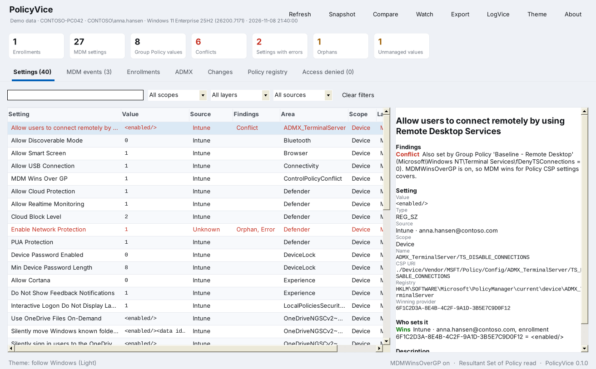
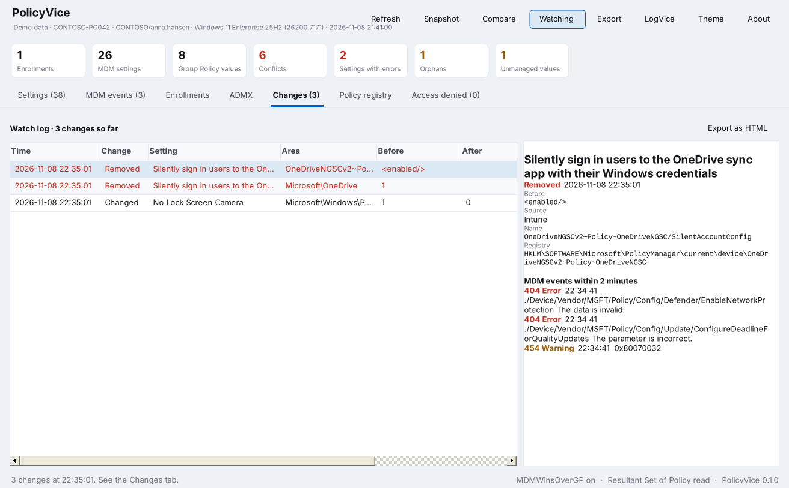

<p align="center"></p>

# PolicyVice

PolicyVice shows what policy is set on a Windows device, who set it, and why it failed or disappeared. It reads MDM (Intune) policy, ADMX ingested through MDM, Group Policy and the policy registry, and puts them side by side with the MDM errors from the event log.

It is a companion to [LogVice](https://github.com/Baldissera88/LogVice): one portable exe, no installs, no cloud sign-in, and it opens the right logs in LogVice with one click.



## What it shows

| Tab | Contents |
|---|---|
| Settings | Every MDM setting and every value under `SOFTWARE\Policies`, with value, source, scope and findings |
| MDM events | Errors and warnings from the DeviceManagement Admin channel, parsed into CSP URI and result |
| Enrollments | MDM enrollments: provider, user, type, state and enrollment ID |
| ADMX | ADMX files ingested through MDM, such as OneDrive and Office |
| Changes | The watch log, or the result of a comparison |
| Policy registry | A raw view of every value under `SOFTWARE\Policies` |
| Access denied | Keys that could not be read |

Select a setting to see where it comes from: the CSP URI, the registry path, every provider or GPO that sets it and which one wins, the findings and the ADMX description.

## Findings

| Finding | Meaning |
|---|---|
| **Conflict** | MDM and Group Policy both configure the same setting. PolicyVice also says whether `MDMWinsOverGP` is on. |
| **Error** | The DeviceManagement event log has a failure for this CSP URI in the last 7 days. |
| **Orphan** | The value is in `PolicyManager\current`, but no MDM provider sent it. A removed profile or enrollment may have left it behind. |
| **Unmanaged** | A value under `HKLM\SOFTWARE\Policies` that no GPO and no MDM setting claims. It is often tattooed, or written by a script or an app. |

Click a count at the top to filter on it.

## Watch and compare

**Watch** follows `PolicyManager\current` and the `Policies` keys while PolicyVice is open. Every time they change, it reads the device again and records what was added, removed or changed, together with the MDM events from two minutes around it. This catches policy that disappears, such as keys wiped by another tool.



**Snapshot** saves the whole state as a JSON file. **Compare** compares the device with a saved snapshot, or two snapshots with each other, for example before and after a change, or a working device against a broken one.

## LogVice

The **LogVice** button opens the MDM event logs, the Intune Management Extension log, Group Policy events or Entra ID events in LogVice. PolicyVice finds LogVice from its MSI install, from `App Paths`, or next to `PolicyVice.exe`. If LogVice is somewhere else, choose **Locate LogVice** once.

## Download and install

Download `PolicyVice.exe` to run it without installing, or `PolicyVice.msi` to install it for all users:

```powershell
msiexec /i PolicyVice.msi /qn
```

PolicyVice needs .NET Framework 4.5 or later, which is part of every supported Windows version. Run it as administrator to read every key and Resultant Set of Policy. Without administrator rights it still works, but more owners show as Unknown.

## Command line

```text
PolicyVice.exe                          Open the window
PolicyVice.exe <snapshot.json>          Open a saved snapshot
PolicyVice.exe /snapshot <file.json>    Save a snapshot of this device
PolicyVice.exe /report <file.html>      Save an HTML report of this device
PolicyVice.exe /csv <file.csv>          Save all settings as CSV
PolicyVice.exe /diff <a.json> <b.json> [/out <file.html>]
/days <n>                               Days of MDM events to read (default 7)
```

The exit code is 0 when done, 1 on an error, and 2 when `/snapshot`, `/report` or `/csv` found conflicts, errors, orphans or unmanaged values. PolicyVice is a Windows app, so PowerShell does not wait for it on its own. Use `Start-Process` with `-Wait`:

```powershell
$p = Start-Process -FilePath "$env:ProgramFiles\PolicyVice\PolicyVice.exe" -ArgumentList '/report', "$env:TEMP\PolicyVice.html" -Wait -PassThru
$p.ExitCode
```

## How it works

| Source | Location |
|---|---|
| MDM values | `HKLM\SOFTWARE\Microsoft\PolicyManager\current\device` and `current\<SID>`, with `_WinningProvider` |
| MDM providers | `PolicyManager\providers\<enrollment ID>\default` |
| Enrollments | `HKLM\SOFTWARE\Microsoft\Enrollments` |
| Ingested ADMX | `PolicyManager\AdmxInstalled` and `%ProgramData%\Microsoft\PolicyManager\ADMXIngestion` |
| Policy registry | `HKLM\SOFTWARE\Policies`, `HKCU\SOFTWARE\Policies` and `HKU\<SID>\SOFTWARE\Policies` for MDM users |
| Group Policy | WMI `root\RSOP\Computer`, `RSOP_RegistryPolicySetting` and `RSOP_GPO` |
| MDM errors | `Microsoft-Windows-DeviceManagement-Enterprise-Diagnostics-Provider/Admin` |
| Names and descriptions | ADMX and ADML files in `%WINDIR%\PolicyDefinitions` and the ingested ADMX |

PolicyVice only reads. It writes nothing to the device except its own settings in `HKEY_CURRENT_USER\Software\PolicyVice` and the files you save.

## Known limitations

- Conflicts are found for ADMX-backed Policy CSP settings (`ADMX_` areas), ingested ADMX, and by area for Update, Defender, Delivery Optimization, Power, WindowsLogon and Experience. Other Policy CSP settings are not matched to their Group Policy counterpart yet.
- User Group Policy is not read, so user values under `Policies` show the source Unknown.
- Settings that are not ADMX-backed get their name from the setting itself, such as `AllowAutoUpdate` shown as Allow Auto Update.
- Win32 apps, scripts and remediations from the Intune Management Extension are not shown.
- Watch only runs while PolicyVice is open.
- The exe and MSI are unsigned. SmartScreen warns on downloaded copies, and AppLocker or WDAC need them signed with your own certificate.

## Try it without a device

`PolicyVice.exe --demo` opens the window with sample data from a made-up device, including a conflict, an orphan, an unmanaged value and a simulated change when you press Watch. The screenshots in this README come from the demo.

## Build from source

PolicyVice is plain C# 5 and Windows Forms on .NET Framework 4.5, with no NuGet packages, just like LogVice.

**On Windows**, with the compiler that ships with .NET Framework:

```powershell
.\build.ps1          # PolicyVice.exe
.\build.ps1 -Msi     # also PolicyVice.msi, needs WiX Toolset 3
```

**On Linux or macOS**, with Mono and msitools:

```sh
./build.sh           # PolicyVice.exe
./package.sh         # PolicyVice.exe and PolicyVice.msi
./tests/run.sh       # the tests
```

| Path | Contents |
|---|---|
| `src/Model.cs` | Snapshot, settings, findings, enrollments, JSON save and load |
| `src/Sources.cs` | Registry, Resultant Set of Policy and event log readers |
| `src/Admx.cs` | ADMX and ADML catalog for names and registry mapping |
| `src/Collect.cs` | Reads the device and finds conflicts, errors, orphans and unmanaged values |
| `src/Diff.cs` | Snapshot comparison and the registry watcher |
| `src/Report.cs` | HTML and CSV export |
| `src/LogViceLink.cs` | Finds and opens LogVice |
| `src/Ui.*.cs` | The window, controls and themes (the same palettes as LogVice) |
| `src/Demo.cs` | Sample data for `--demo` |
| `tests/` | Tests for the collector, findings, snapshots, diff and exports |
| `art/` | The icon, drawn in the same style as the LogVice icon |

## License

PolicyVice is released under the [MIT license](LICENSE).

## Author

Developed by **Daniel L. Baldissera**.
